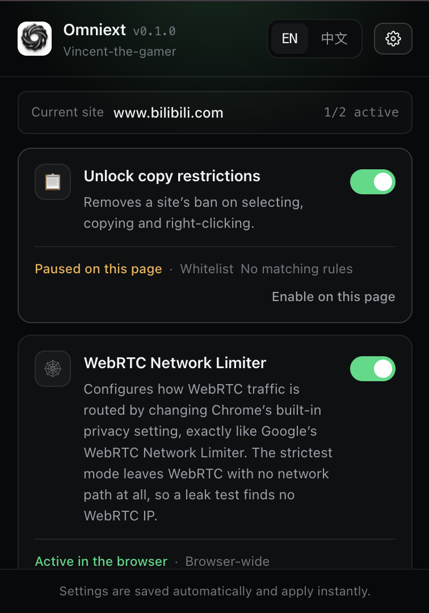

# Omniext

Omnipotent browser extension.

> [!WARNING]
> This repo is under construction.

## Abilities

Omniext keeps a few small fixes in one extension. Every feature has its own switch
and domain rules, saved in your browser, and the ones that change browser settings
apply browser-wide.

## Features

- **Unlock copy restrictions** — restores selecting, copying and right-clicking on sites that block them.
- **WebRTC Network Limiter** — sets Chrome's WebRTC IP policy so a site cannot read your real or local IP.
- **Interface language** — English or Chinese, and your choice is remembered.

More features coming soon.

## Preview

## License

[MIT](./LICENSE)
